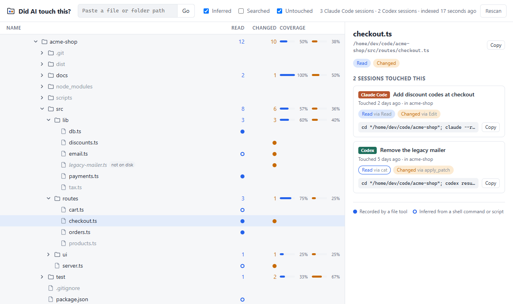

# Did AI touch this?

[](https://github.com/vrohak/did-ai-touch-this/actions/workflows/ci.yml)

See which files your coding agents read, changed or searched. **Did AI touch this?** reads the transcripts that Claude Code and Codex already keep on your machine and shows what they touched as a folder tree you can browse.

<picture>
  <source media="(prefers-color-scheme: dark)" srcset="docs/screenshot-dark.png">
  
</picture>

- **Counts per folder:** how many files under each folder were read, and how many were changed.
- **Coverage:** what share of a folder's files the agents read and changed, so you can see which parts of a repo an agent has actually looked at.
- **Did AI touch this?** Pick any file or folder to see every session that touched it, when and how, with the command that resumes the session.
- **Local, with no dependencies:** one Node.js process on your machine. Nothing leaves it.

## Quick start

You need [Node.js](https://nodejs.org) 24.2 or later, and git for coverage inside git repos.

```sh
git clone https://github.com/vrohak/did-ai-touch-this.git
cd did-ai-touch-this
npm start
```

Then open <http://localhost:4477>. There's nothing to install, since the app has no runtime dependencies. The first start reads every transcript, which takes about a minute for a few gigabytes of them; later starts and **Rescan** only read what's new.

## Using it

| Column | What it counts |
| --- | --- |
| **Read** | Files whose content an agent read. |
| **Changed** | Files an agent created, edited, moved or deleted. |
| **Searched** | Folders an agent listed or searched, and files whose existence it checked. Searching a folder doesn't count as reading the files in it. Hidden until you tick **Searched**. |
| **Coverage** | The share of a folder's files on disk now that were read (blue) and changed (orange). |

Files get a dot for each kind of touch: filled when a file tool recorded it, a ring when it was inferred from a shell command (see [How it works](#how-it-works)). Files that were touched but are gone from disk are marked **not on disk**.

- Untick **Inferred** to count only touches that file tools recorded.
- Untick **Untouched** to hide the files and folders no agent touched.
- Paste a path into the box at the top to jump to it.

The side panel lists the sessions that touched the selected file or folder, newest first. Each comes with a resume command to copy, such as `cd "/home/me/shop"; claude --resume <id>` (Claude Code finds a session from the folder it started in) or `codex resume <id>`.

## How it works

It reads these transcripts:

| Agent | Where | To read them elsewhere, set |
| --- | --- | --- |
| Claude Code | `~/.claude/projects` | `CLAUDE_CONFIG_DIR` |
| Codex | `~/.codex/sessions` and `~/.codex/archived_sessions` | `CODEX_HOME` |

Some touches are **recorded**: Claude Code's Read, Edit, Write, Grep and Glob tools and Codex's file changes name the exact file. The rest are **inferred** from shell commands and inline scripts. The parser knows the common read, write and search commands of bash and PowerShell (`cat`, `sed -i`, `rg`, `Get-Content`, `Set-Content`, redirects, `git diff`, `git mv` and so on), follows `cd`, simple variables and `for` loops, and reads the file APIs of Python, Node and .NET in inline scripts such as `python - <<'EOF'`. Codex reads almost entirely through the shell, so most of its reads are inferred.

Inferred touches are a best guess from a command's text. They miss paths built at runtime, files a script reads without naming them, and commands the parser doesn't know. Now and then one is wrong, such as a relative path after a `cd` that failed.

Also:

- A subagent's work counts toward the session that started it.
- Claude Code worktrees (`<repo>/.claude/worktrees/<name>`) count as their repo.
- Failed edits and patches don't count.
- Inside a git repo, coverage counts the files git tracks or would track, so ignored build output and dependencies don't count. Outside one, it leaves out dependency and cache folders such as `node_modules`. Folders too big to count show a dash.

## Privacy and security

Transcripts hold everything your agents saw, so the app keeps them on your machine:

- The server listens on `127.0.0.1` only and refuses requests addressed to any other host name, which also stops websites from reaching it through DNS rebinding.
- It makes no network requests of its own.
- It shows paths, session ids and titles (the agent's title for a session, or its first prompt), never file contents.
- It caches what it found in `%LOCALAPPDATA%\did-ai-touch-this\index.json` on Windows and `~/.cache/did-ai-touch-this/index.json` elsewhere. You can delete the cache at any time; the next start rebuilds it.

Set `PORT` to serve on a port other than 4477.

## Development

```sh
npm install     # TypeScript and Node's types, for type-checking
npm test        # behaviour tests
npm run check   # type-check
```

Node runs the TypeScript directly, so there's no build step, and the UI in `public/` is plain HTML, CSS and JavaScript.

| File | Role |
| --- | --- |
| `src/shell.ts` | Infers touches from bash and PowerShell commands. |
| `src/script.ts` | Infers touches from inline Python, Node and .NET code. |
| `src/claude.ts`, `src/codex.ts` | Read each agent's transcripts. |
| `src/scan.ts` | Finds transcripts, caches what they say and merges each session's parts. |
| `src/tree.ts` | The tree of touched paths and its counts. |
| `src/disk.ts` | What's on disk, and which files count for coverage. |
| `src/server.ts` | The HTTP API. |

To teach the parser a new command, add it to the handler tables in `src/shell.ts`, with a test in `test/shell.test.ts`.

## Contributing

Issues and pull requests are welcome. When the tree gets something wrong, the most useful report is the command or transcript lines behind it, with private paths changed: it becomes a test. Neither agent documents its transcript format, and Codex's has changed several times, so reports of a new version that doesn't read correctly are especially welcome.

## License

[MIT](LICENSE). This project isn't affiliated with Anthropic or OpenAI.
